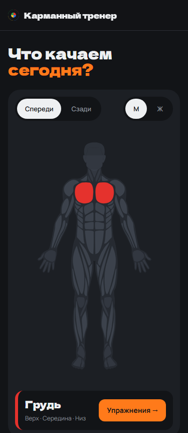

# Карманный тренер

Бесплатный каталог упражнений для тренажёрного зала. Выбираешь мышцу на схеме тела — видишь упражнения
на неё: техника по шагам на русском, частые ошибки, ролик. Работает на телефоне, позже — и без интернета.

**Сайт:** https://vpopchenya.github.io/trenirovki/



## Что умеет
- Схема тела спереди и сзади, мужская и женская фигура — нажми на мышцу.
- 7 групп мышц: грудь, спина, плечи, руки, ноги, ягодицы, пресс — у каждой свой цвет, как у блинов на штанге.
- Скоро: упражнения с техникой, готовые программы, дневник тренировок, установка на телефон.

## Как запустить
Нужен Node.js 22.

```bash
npm install
npm run dev
```

Откроется http://localhost:4321/trenirovki/

## Как устроено
- [Astro](https://astro.build) собирает отдельную страницу на каждую группу мышц (позже — и на каждое упражнение).
- Данные — в `src/data/`, оформление — `src/styles/global.css`, общий каркас страницы — `src/layouts/Base.astro`.
- Каждый push в `main` собирается и выкладывается на GitHub Pages (`.github/workflows/deploy.yml`).

## Как проверяется
Пока — сборка без ошибок, ревью каждого изменения и скриншоты на ширинах 375, 768, 1280.
Автотесты на pytest + Playwright появятся, когда каталог будет готов.

## Чужие материалы
Схема тела — [react-native-body-highlighter](https://github.com/HichamELBSI/react-native-body-highlighter),
© 2022 ELABBASSI Hicham, лицензия MIT (`src/data/body.LICENSE.txt`).
